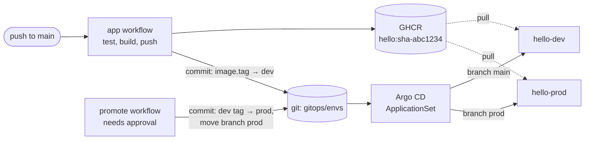

# eks-gitops-platform

[](https://github.com/VorobevPavell/eks-gitops-platform/actions/workflows/app.yml)
[](https://github.com/VorobevPavell/eks-gitops-platform/actions/workflows/k8s.yml)
[](https://github.com/VorobevPavell/eks-gitops-platform/actions/workflows/terraform.yml)

An EKS platform described in Terraform, with GitOps delivery through Argo CD: CI builds an image and
deploys it by committing the new tag to git, Argo CD syncs the cluster, and production gets the same
image only through an approved promotion commit.

Every pull request proves the delivery path on a throwaway kind cluster: Argo CD pulls the commit
under test, both environments must reach `Synced/Healthy`, the service must answer, and Argo CD must
restore a deployment deleted by hand.

## Delivery flow



CI never holds cluster credentials. Dev follows `main`; prod follows the `prod` branch, so chart and
values changes reach production only through a promotion, like images do. Rollback is `git revert` of
the deploy commit; each commit says which tag it replaced.

## What is where

| Path | What it is |
| --- | --- |
| `app/` | Go service: `/`, `/healthz`, `/readyz`, Prometheus `/metrics`, graceful shutdown that fails readiness first |
| `charts/hello/` | Helm chart: non-root read-only container, probes, zero-downtime rolling update, zone spread; HPA, PDB and ServiceMonitor behind flags |
| `gitops/bootstrap/root.yaml` | App-of-apps root; Terraform installs exactly this manifest |
| `gitops/apps/` | AppProject with an allow-list of kinds, the `hello` ApplicationSet (dev, prod), kube-prometheus-stack |
| `gitops/envs/{dev,prod}/values.yaml` | The only files a deploy changes |
| `terraform/modules/network` | VPC across 2–4 zones, public/private subnets tagged for load balancers, NAT per zone or shared, flow logs |
| `terraform/modules/eks` | EKS with access entries, KMS-encrypted secrets, audit logs, private endpoint by default, managed node group, add-ons in dependency order |
| `terraform/modules/argocd` | Argo CD and the root application through Helm |
| `terraform/envs/dev` | The modules wired together; S3 backend with native locking |
| `scripts/set-image-tag.sh` | Deploy-by-commit used by CI |
| `scripts/promote.sh` | Promotion of a revision dev has run; refuses if main changed what prod renders since |
| `scripts/e2e.sh` | kind + Argo CD end-to-end check |
| `docs/decisions.md` | Why it is built this way |

## How it is verified

| Check | Tool | Runs on |
| --- | --- | --- |
| Service behaviour | `go test -race` | every PR |
| Module logic: subnet math, tags, validations, hardening defaults, add-on order | `terraform test` with mocked AWS and Helm providers | every PR |
| Formatting, provider rules | `terraform fmt`, `terraform validate`, `tflint` with the AWS ruleset | every PR |
| Misconfigurations in Terraform, manifests, Dockerfile | `trivy config` | every PR |
| Chart and manifests against Kubernetes and CRD schemas | `helm lint`, `kubeconform -strict` | every PR |
| GitOps delivery end to end | kind + Argo CD (`scripts/e2e.sh`) | every PR |

The Terraform code has not been applied to a real AWS account: the mocked tests prove the
configuration logic, not AWS API behaviour. See decision 9.

## Run it locally

Requirements: Docker, kind, kubectl, Helm 4, Terraform ≥ 1.10, tflint, kubeconform, Go, yq v4.

```sh
make test     # go test + terraform test for every module
make lint     # fmt, validate, tflint, helm lint, kubeconform
make e2e      # kind cluster, Argo CD, sync from the current commit (must be pushed)
make e2e-down
```

`make e2e` reads the repository from GitHub at `git rev-parse HEAD`. To test against a fork or a local
mirror, set `REPO_URL`.

## Repository setup

These live in GitHub settings, not in code:

1. Settings → Environments → `prod`: add required reviewers and limit deployment branches to `main`.
   Without it the `promote` workflow runs with no approval.
2. Settings → Rules → a ruleset for the `prod` branch: block force pushes and deletion, restrict
   updates, and put the promote workflow's identity (GitHub Actions or a deploy key it pushes with) on
   the bypass list. Without it a direct `git push origin X:prod` deploys to prod with no approval.
3. After the first `app` run, make the `hello` package in GHCR public, or give the cluster an image
   pull secret.
4. Run `promote` once with the commit `hello-dev` is synced to. It creates the `prod` branch; until
   then `hello-prod` reports that it cannot resolve revision `prod`, and dev runs alone.

`promote` refuses a revision if `main` has changed `charts/` or the prod values since it, because that
change has not run in dev yet.

## Deploy to AWS

Additionally requires AWS CLI v2: the Helm provider authenticates to the cluster with `aws eks get-token`.

```sh
cd terraform/envs/dev
cp backend.hcl.example backend.hcl            # an existing S3 bucket for state
cp terraform.tfvars.example terraform.tfvars  # your IP; admin roles must include the one running apply
terraform init -backend-config=backend.hcl
terraform plan -out=tfplan
terraform apply tfplan
$(terraform output -raw configure_kubectl)
kubectl -n argocd get applications
```

Rough cost of the dev environment in eu-central-1: the EKS control plane ($0.10/h), one NAT gateway
(about $0.05/h plus traffic) and two spot t3.medium nodes (a few cents per hour), so roughly
$0.20/h. Check current AWS pricing before applying.

Tear down Argo CD first, while the cluster still answers, then the rest:

```sh
terraform destroy -target=module.argocd
terraform destroy
```

## Next steps

- Apply to a real account and record what the mocks missed.
- AWS Load Balancer Controller with the Gateway API, installed through Pod Identity.
- External Secrets Operator reading AWS Secrets Manager.
- Argo Rollouts canary for prod, gated on the service's own error-rate metric.
- Separate clusters and accounts for dev and prod.
